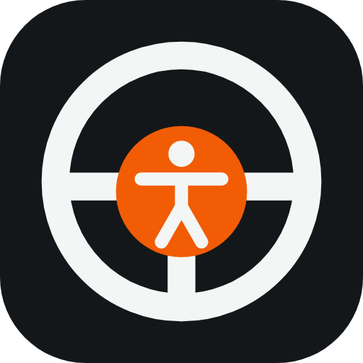
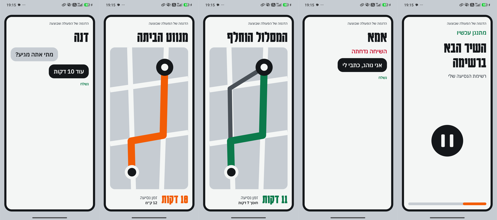

# AutoAccess

Android Auto for drivers who cannot speak or hear. Answer a message, start navigation or
decline a call while driving, with one hand and no voice.

Android Auto's hands-free input is voice: messages are read aloud and answered by speaking.
A deaf-mute driver is locked out of all of it, and steering-wheel buttons only cover volume,
next track and answering a call. AutoAccess uses the phone's front camera, on a dash mount,
to read hand and head gestures instead.

## How it works

| Gesture | What it does |
|---|---|
| Open palm | Opens the menu (navigation, message, music) |
| 1, 2 or 3 fingers | Picks an option. A ring closes around it in 1.4 s, then it is carried out |
| Another number while the ring runs | Changes the pick |
| Fist held for 1.2 s (a red ring fills), or a head shake | Cancels |
| Thumb up, or a nod | Optional shortcut: carry out the pick at once |
| Fist held for 3 seconds | Emergency alert, from any screen |

Design rules: at most three options per screen, every prompt closes by itself, and nothing
is carried out without a pick, so a stray movement cannot send anything. Feedback is purely
visual (a dial, big numbers, colour), because the driver cannot hear a confirmation.



## What is built

- On-device recognition with MediaPipe (hand landmarks and head pose). No video leaves the phone.
- Finger counting from landmark geometry; nod and shake detection calibrated on recorded head movement.
- A gesture grammar state machine (`app/src/main/java/dev/accessauto/grammar`), pure Kotlin.
- Drive screen and gesture training screen, portrait and landscape, Hebrew UI.
- Result screens that show what each action did.
- 30 unit tests, two of which replay real recorded head movement.

## Status

This is a working prototype of the interaction, not a finished product. The driving
situations (incoming message, call, traffic reroute, arrival) are simulated and **nothing is
actually sent**. Not built yet: real message replies and navigation, the Android Auto
head-unit screen, the emergency SMS, and Claude-written message summaries and reply suggestions.

## Build

Requires the Android SDK (compileSdk 37) and JDK 17 or newer.

```
./gradlew testDebugUnitTest assembleDebug
adb install -r app/build/outputs/apk/debug/app-debug.apk
```

Built with Claude Code.
